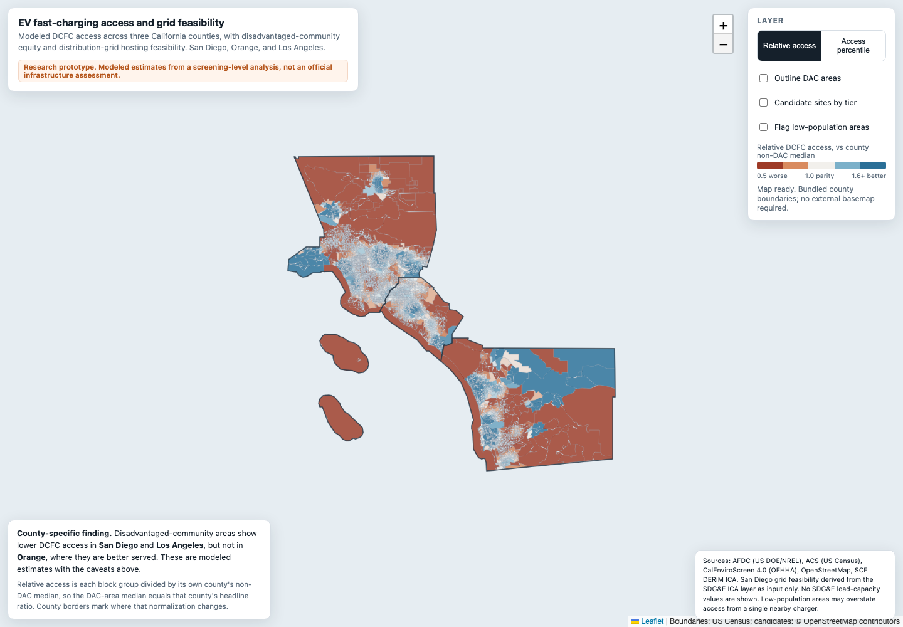

# EV charging equity and grid-constrained siting

[](https://github.com/Arnav66692/EV-Charging-Access-San-Diego-version-2/actions/workflows/ci.yml)

A research pipeline for charging accessibility, queueing-adjusted supply,
distribution-grid feasibility, and candidate siting in San Diego, Orange, and
Los Angeles counties. This extends the [San Diego access study](https://github.com/Arnav66692/EV-Charging-Access-San-Diego).
It contains work through Phase 5; the original “Phase 1” label is obsolete.

**Reported finding:** the modeled disadvantaged-community DCFC access deficit
appears in San Diego and Los Angeles, but not Orange County. Results depend on
county-specific normalization, demand, and screening assumptions. Candidate
feasibility is not an interconnection approval or proof of parcel buildability.

Read the [paper draft](paper/draft.md), [figures and tables](paper/02-figures-and-tables.md),
and [mechanism diagnostic](paper/04-mechanism-diagnostic.md).



## What is available

| Component | Implemented | Evidence and reproduction boundary |
| --- | --- | --- |
| Acquisition and spatial joins | AFDC, ACS, CES crosswalk, OSM, SCE and local SDG&E inputs | Small fixtures and manifests committed; full raw/processed inputs are not |
| Accessibility | SFCA methods, Euclidean and OSRM providers | Offline mathematical tests; live OSRM run requires Docker and input data |
| Queueing and grid screening | Effective capacity and tier feasibility | Fixture tests and method notes; private utility input stays local |
| Optimization and robustness | Siting objectives and sensitivity analysis | Recorded paper/manifests; not a fresh full-pipeline reproduction |
| Public map | Bundled derived GeoJSON and interactive layers | No tile API key; Leaflet assets load from a pinned CDN |

The research artifacts describe the recorded analysis. Green CI validates
fixtures, shipped-data schemas, and map behavior; it does not certify that the
full live-data analysis was independently rerun.

## Run the offline checks

```bash
python3.12 -m venv .venv
.venv/bin/python -m pip install -r requirements.txt
.venv/bin/python -m pytest -q
```

These Python tests need no keys, private data, OSRM server, or Docker.
CI also opens the map at desktop and mobile widths and tests layer controls and
failed data loading. The map smoke test uses Playwright; see `.github/workflows/ci.yml`.

## View the map

```bash
.venv/bin/python -m http.server 8000 --directory web
```

Open [localhost:8000](http://localhost:8000). The map uses bundled county
boundaries rather than a remote tile service, so it remains useful without a
basemap API key. An internet connection is needed for Leaflet's pinned assets.
Controls precede the map on narrow screens; errors appear in a visible status area.

## Reproduce with source inputs

Follow [acquisition and routing](docs/acquisition.md) for API keys, CES inputs,
SDG&E local files, and Docker setup. `data/raw`, `data/interim`, and
`data/processed` are ignored. They are **not** populated by cloning the repo.
`data/snapshots` contains fixtures, not a complete frozen research dataset.
Do not interpret a new AFDC pull as the published station snapshot.

### Euclidean compatibility gate

Supply a polygon file with string `geoid_bg` identifiers. The command computes
geometric centroids, uses processed ACS/CES tables, and exits nonzero if the
check fails:

```bash
make access-gate GATE_ARGS="--block-groups data/raw/block_groups.geojson"
```

Without a snapshot/reference pair this checks only the qualitative access
pattern. To compare a real frozen AFDC **API JSON** snapshot against a recorded
ratio, add both options:

```bash
make access-gate GATE_ARGS="--block-groups data/raw/block_groups.geojson --snapshot data/raw/frozen_afdc.json --reference-ratio 0.6845 --tolerance 0.01"
```

Use the reference ratio appropriate to your frozen study inputs. The example is
the current v1 paper's population-weighted median ratio. The gate reads station
supply from the snapshot (operating, public DCFC), hashes its bytes and the actual
origin/demand/DAC inputs, and writes `manifests/access_v1_gate.json`.
A tolerance match is labeled `frozen_supply_comparison`, **not exact reproduction**:
matching demographics, centroid definitions and model settings also matter.
The historical manifest's former exact-reproduction claim is marked unverified;
its old 0.6321 reference is not the current paper's 0.6845 headline.

### Primary drive-time path

`make access-primary` needs processed data, population-weighted centroids,
LODES demand and a live OSRM instance. This is distinct from the Euclidean
compatibility path; offline fixtures do not validate live travel times.

## Methods and scope

- [Accessibility](docs/methods_accessibility.md)
- [Queueing](docs/methods_queueing.md)
- [Grid feasibility](docs/methods_grid_feasibility.md) and [field interpretation](docs/grid_fields.md)
- [Optimizer](docs/methods_optimizer.md)

Geometries are stored in EPSG:4326 and distance calculations use EPSG:3310.
County-based territory selection approximates utility service areas. LADWP's
Los Angeles core is outside the utility-layer scope and must not be treated as
verified SCE coverage. Low-population areas can overstate per-person access.

## License and contributions

The author's code is [MIT licensed](LICENSE). Third-party data keeps its own
terms and attribution; see [LICENSING.md](LICENSING.md). Raw SDG&E data and load
capacity values are excluded from public artifacts. See [CONTRIBUTING.md](CONTRIBUTING.md)
for review and release requirements.
